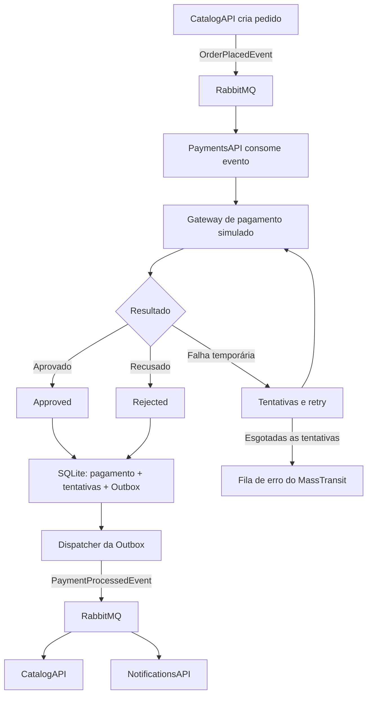

# FCG PaymentsAPI

Microsserviço de pagamentos da **FIAP Cloud Games (FCG)**, responsável por processar **pagamentos simulados** de pedidos criados pelo CatalogAPI e informar o resultado aos demais serviços por meio de eventos.

A aplicação utiliza **.NET 8**, **MassTransit**, **RabbitMQ**, **Entity Framework Core** e **SQLite**. Sua comunicação principal é assíncrona: o PaymentsAPI recebe um pedido da fila e publica o resultado, sem realizar cobranças reais ou manipular dados de cartão.

## Visão geral do funcionamento



1. O **CatalogAPI** publica o evento `OrderPlacedEvent` quando um pedido é criado.
2. O **PaymentsAPI** recebe o evento pela fila `payments-order-placed`, vinculada à exchange `FCG_CatalogAPI:OrderPlacedEvent`.
3. O serviço valida os dados do pedido e verifica se ele já foi processado, evitando gravar o mesmo pagamento novamente.
4. O **gateway simulado** determina o resultado com base no valor da compra e nas regras configuradas.
5. Para resultados definitivos, a aplicação grava **pagamento, tentativas e evento de saída na Outbox em uma transação SQLite**.
6. Um serviço em segundo plano, o **PaymentEventDispatcher**, consulta a Outbox e publica `PaymentProcessedEvent` no RabbitMQ. Após a publicação, o registro é marcado como enviado; se houver falha, permanece pendente para nova tentativa.
7. **CatalogAPI** e **NotificationsAPI** recebem o evento em suas próprias filas e executam as respectivas ações. O PaymentsAPI apenas publica o resultado, não atualiza diretamente os bancos desses serviços.

### Eventos trocados

**Entrada — `OrderPlacedEvent`**

```json
{
  "OrderId": "11111111-1111-1111-1111-111111111111",
  "UserId": 10,
  "GameId": 20,
  "Price": 100.00
}
```

**Saída — `PaymentProcessedEvent`**

```json
{
  "OrderId": "11111111-1111-1111-1111-111111111111",
  "UserId": 10,
  "GameId": 20,
  "Price": 100.00,
  "Status": "Approved",
  "ProcessedAtUtc": "2026-11-06T15:00:00Z",
  "Reason": null
}
```

Os eventos usam contratos do namespace `Fcg.Contracts` e são transportados como **JSON bruto** pelo RabbitMQ, com configuração de serialização/desserialização no MassTransit. A exchange de saída é `FCG_PaymentsAPI:PaymentProcessedEvent`, e os consumidores precisam vincular suas próprias filas a ela. Os exemplos acima contêm dados ilustrativos.

## Simulação de pagamentos

O gateway é **fictício**: o resultado depende do valor do pedido, conforme as faixas definidas em `src/Payments.API/appsettings.json`.

| Valor do pedido | Simulação | Resultado |
| --- | --- | --- |
| R$ 0,01 a R$ 499,99 | Aprovação | `Approved` |
| R$ 500,00 a R$ 699,99 | Saldo insuficiente | `Rejected` |
| R$ 700,00 a R$ 799,99 | Cartão inválido | `Rejected` |
| R$ 800,00 a R$ 899,99 | Gateway indisponível | Falha temporária |
| R$ 900,00 a R$ 999,99 | Timeout | Falha temporária |
| R$ 1.000,00 a R$ 999.999,99 | Limite excedido | `Rejected` |

- **Approved:** pagamento aprovado; gera evento com `Status = "Approved"`.
- **Rejected:** pagamento recusado por regra de negócio; gera evento com `Status = "Rejected"` e justificativa em `Reason`.
- **Falha temporária:** o gateway lança uma exceção; o serviço realiza até **3 tentativas internas**, com intervalo progressivo, e o MassTransit também aplica seus retries configurados (**500 ms, 1 s e 3 s**). Se a entrega continuar falhando, a mensagem pode seguir para a fila de erro (`_error`). Esse cenário **não gera automaticamente** um evento de recusa financeira.

Valores positivos que não correspondam a nenhuma faixa configurada resultam em rejeição (`NO_MATCHING_RULE`).

## Persistência e confiabilidade

O banco de dados **SQLite** armazena:

- **Payments:** pedido, valor, status, resultado, identificadores e data de processamento.
- **PaymentAttempts:** histórico das tentativas de processamento efetivamente persistidas.
- **OutboxMessages:** eventos que precisam ser publicados no RabbitMQ e informações de controle de entrega.

O padrão **Transactional Outbox** mantém o resultado do pagamento e o evento de saída na mesma transação, reduzindo o risco de salvar o pagamento sem registrar o evento que será enviado. O dispatcher verifica eventos pendentes periodicamente (a cada **2 segundos**) e os publica em lotes de até **50**.

O `OrderId` é utilizado na verificação de duplicidades e na associação de pagamentos, tentativas e eventos. A publicação pela Outbox segue a semântica **at-least-once**; portanto, os serviços consumidores também devem tolerar possíveis mensagens repetidas.

## API HTTP e observabilidade

O processamento de pagamentos acontece **por eventos**, não por uma rota HTTP de criação de pagamento. A API HTTP é utilizada principalmente para consulta e diagnóstico.

| Método | Endpoint | Função |
| --- | --- | --- |
| GET | `/health` | Verifica se a aplicação está ativa (*liveness*). |
| GET | `/ready` | Verifica a conectividade com o SQLite (*readiness*); não verifica o RabbitMQ. |
| GET | `/api/payments/{orderId}` | Consulta o pagamento de um pedido, incluindo status, motivo e quantidade de tentativas. |
| GET | `/api/payments/{orderId}/attempts` | Consulta o histórico de tentativas (**Development**). |
| GET | `/api/payments/stats` | Exibe estatísticas agregadas (**Development**). |
| GET | `/dashboard` | Painel web de estatísticas (**Development**). |
| GET | `/swagger` | Interface de documentação da API (**Development**). |

O `/dashboard` atualiza os indicadores periodicamente, a cada **10 segundos**. O endpoint `/api/payments/{orderId}` devolve `404` quando o pedido não é encontrado.

A aplicação registra informações de processamento e publicação de eventos, permitindo acompanhar o fluxo pelo **OrderId** e pelo **CorrelationId**. Na configuração de logs aprimorada, utiliza **Serilog** para padronização das mensagens, com redução do ruído gerado pelos componentes internos do .NET, EF Core e RabbitMQ.

## Organização do projeto

```text
FCG_PaymentsAPI/
├── src/
│   ├── Payments.API/             # Endpoints, inicialização e configuração
│   ├── Payments.Application/     # Casos de uso, contratos e interfaces
│   ├── Payments.Domain/          # Entidades e regras de domínio
│   └── Payments.Infrastructure/  # SQLite, RabbitMQ, gateway e Outbox
├── tests/
│   └── Payments.Domain.Tests/    # Testes automatizados
├── Dockerfile
├── Payments.sln
└── README.md
```

### Tecnologias e integrações

| Componente | Utilização |
| --- | --- |
| .NET 8 / ASP.NET Core | Execução do microsserviço e endpoints HTTP |
| MassTransit + RabbitMQ | Consumo e publicação assíncrona de eventos em JSON bruto |
| Entity Framework Core + SQLite | Persistência dos pagamentos, tentativas e Outbox |
| Gateway simulado | Aprovação, recusa e falhas temporárias configuráveis |
| Serilog | Logs estruturados na versão com logging atualizado |
| Docker / Kubernetes | Execução em contêineres e orquestração |

## Execução no ecossistema FCG

O PaymentsAPI faz parte do conjunto de microsserviços **UsersAPI**, **CatalogAPI**, **PaymentsAPI** e **NotificationsAPI**. Sua execução integrada depende do RabbitMQ e das configurações de conexão com o SQLite.

A configuração de **Docker Compose, Kubernetes, Deployments, Services, ConfigMaps e Secrets** fica centralizada no repositório **`FCG-Orchestration`**, responsável por executar os serviços em conjunto. O `Dockerfile` deste repositório permite empacotar o PaymentsAPI em uma imagem de contêiner.

---

**Escopo:** implementação acadêmica da FIAP Cloud Games, com **processamento financeiro inteiramente simulado**. Não efetua cobranças bancárias nem integra adquirentes reais.
